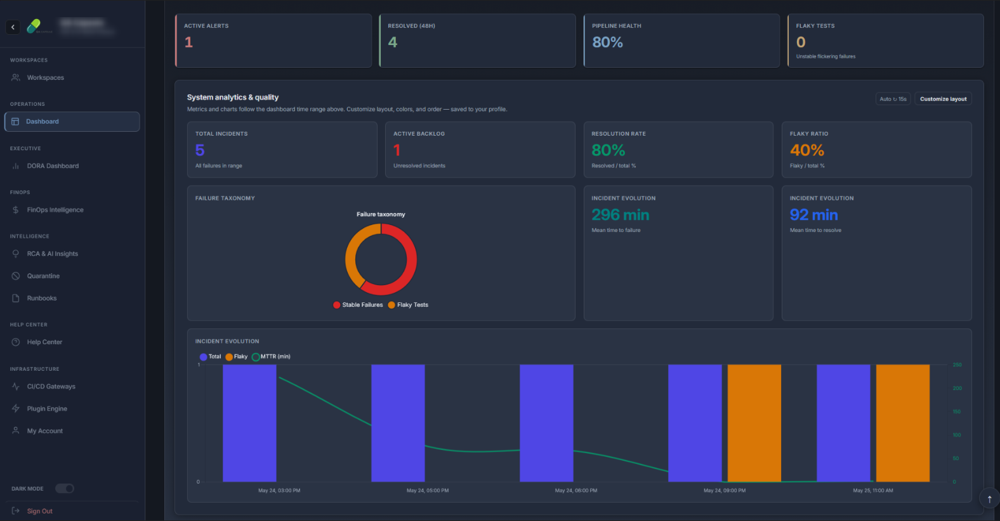
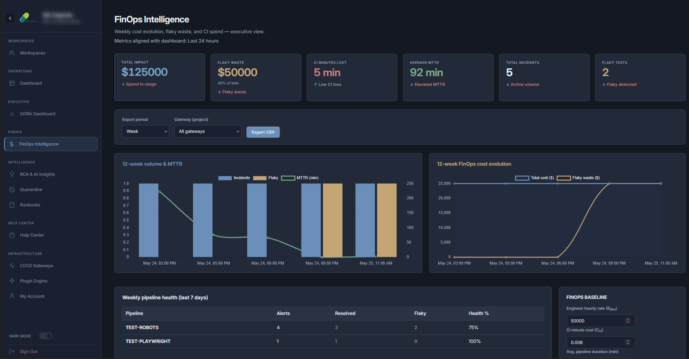
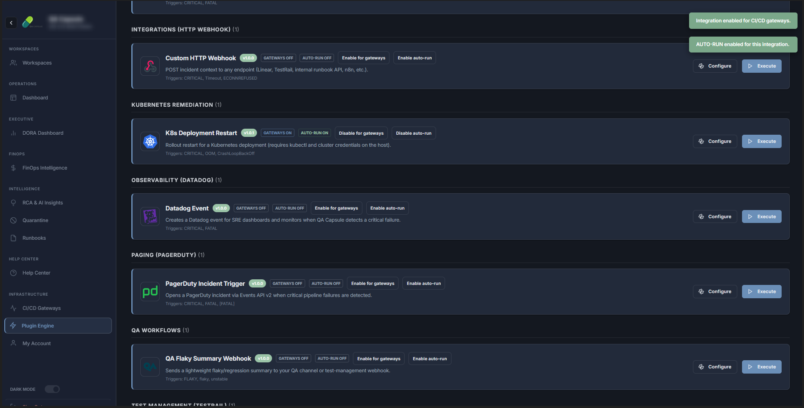
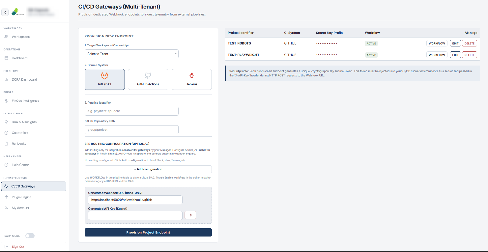

# SRE Flight Recorder (SRE Capsule) — Community

[](https://sre-capsule.github.io/sre-capsule-community/)


**SRE Capsule** is an SRE control plane for CI/CD and E2E test failures: ingest, correlate, quarantine flaky tests, run native integrations (no shell plugins), AI RCA, FinOps, DORA, and a full web dashboard.

<p align="center">
  
</p>

<p align="center">
  
</p>

<p align="center">
  
</p>

<p align="center">
  
</p>

<p align="center">
  
</p>

---

## Why SRE Capsule?

A pipeline log is a signal. SRE Capsule keeps the record the team works from: the failure on its gateway and its suite, the owner, the status, and the steps of the run. The same open failure in one run stays one incident. A lead or a manager can analyze it, confirm a change, and re-run. An enabled workflow can act on ingest. Plugin Engine holds the connection. The workflow holds the message. Managers read DORA and FinOps on that same record. The product does not invent a cause, and it does not call Slack, Jira, or a cluster from the incident Runbook button.

---

## Feature highlights

| Area | Capability |
|------|------------|
| **Ingestion** | JSON webhooks, JUnit XML, async queue (`202 queued`) |
| **Intelligence** | `[FLAKY]`, `[PERF]` tagging, AI root-cause analysis (RCA), self-healing |
| **Integrations** | Go HTTP engine + visual workflow DAG (Slack, Jira, PagerDuty, GitHub …) |
| **Operations** | Dashboard, Execution Hub, runbooks, FinOps, DORA metrics |
| **Security** | JWT sessions, RBAC, per-project API keys, rate limiting, SSRF guards, MCP token enforcement |
| **Developer tools** | `srecapsule run` CLI, Playwright reporter, JUnit agent, MCP endpoint |

**Full list:** [docs/reference/feature-catalog.md](docs/reference/feature-catalog.md)

---

## Quick start (Docker — recommended)

Works on **Linux, macOS, and Windows** (Docker Desktop or Engine).

```bash
git clone https://github.com/SRE-Capsule/sre-capsule-community.git
cd sre-capsule-community
docker compose up -d --build
docker compose ps   # wait until healthy
```

Open **http://localhost:9000** — sign in with **`admin`** / **`admin`**, then set a new password.

After UI updates:

```bash
docker compose down
docker compose up -d --build --force-recreate
```

| Variable | Compose default | Purpose |
|----------|-----------------|--------|
| `SRECAPSULE_DATA_DIR` | `/app/data` | SQLite + artifacts (volume `srecapsule_data`) |
| `SRECAPSULE_JWT_SECRET` | `dev-compose-change-me` | JWT signing — change in `.env` for real deployments |
| `SRECAPSULE_MCP_TOKEN` | *(unset in dev)* | Required in production (`APP_ENV` ≠ development) |
| `APP_ENV` | `development` | Dev JWT fallback when `jwt_secret` is empty |

Host bind mount for DB inspection:

```bash
mkdir -p data && chmod u+w data
docker compose -f docker-compose.yml -f docker-compose.dev.yml up -d --build
```

---

## Local development (`go run`)

```bash
go run ./cmd/srecapsule/main.go
go build -o bin/srecapsule ./cmd/cli
```

| Issue | Fix |
|-------|-----|
| `readonly database` | `chmod -R u+w data` or use Docker; or fallback to `~/.sre-capsule/data` |
| JWT fatal on start | `export APP_ENV=development` or set `SRECAPSULE_JWT_SECRET` |

```bash
export SRECAPSULE_DATA_DIR=./data
export SRECAPSULE_JWT_SECRET="$(openssl rand -hex 32)"   # production
```

---

## CLI example

```bash
export SRECAPSULE_API_URL=http://localhost:9000
export SRECAPSULE_API_KEY=your_project_key

bin/srecapsule run --test-name "Login" --test-error "assert failed" -- npx playwright test
```

On failure, the CLI warns if the fingerprint is already marked **flaky** in the control plane.

---

## Documentation

| Topic | Link |
|-------|------|
| **Published docs** | https://sre-capsule.github.io/sre-capsule-community/ |
| Home / map | [docs/index.md](docs/index.md) |
| Security & JWT | [docs/setup/security-authentication.md](docs/setup/security-authentication.md) |
| RBAC & Teams | [docs/setup/rbac-teams.md](docs/setup/rbac-teams.md) |
| Webhooks API | [docs/api/webhooks.md](docs/api/webhooks.md) |
| Incidents API | [docs/api/incidents-api.md](docs/api/incidents-api.md) |
| AI & self-healing | [docs/guides/mcp-self-healing-testing.md](docs/guides/mcp-self-healing-testing.md) |
| Plugin engine | [docs/plugins/overview.md](docs/plugins/overview.md) |
| CI/CD integration | [docs/integration/cicd-overview.md](docs/integration/cicd-overview.md) |
| Feature catalog | [docs/reference/feature-catalog.md](docs/reference/feature-catalog.md) |

Build docs locally:

```bash
pip install -r docs/requirements.txt  # or site/requirements.txt
mkdocs serve
```

Generated HTML goes to `site/` (gitignored — do not commit).

---

## Technology stack

| Layer | Stack |
|-------|--------|
| Backend | Go 1.25+, SQLite (`modernc.org/sqlite`) |
| API | `net/http`, JWT (`github.com/golang-jwt/jwt/v5`) |
| Frontend | Vanilla ES modules, Chart.js |
| CLI | Cobra (`cmd/cli`) |
| Docs | MkDocs Material, Roboto 13px compact theme |

---

## Configuration

Copy [config.yaml.example](config.yaml.example) to `config.yaml`. **Never commit** real SMTP passwords or JWT secrets — use environment variables and CI secrets.

Integration secrets (Slack, Jira, …) belong in the **server environment**, not in git.

Example plugin manifest:

```json
{
  "integration": "slack",
  "name": "Critical failures",
  "trigger_on": ["CRITICAL", "FLAKY"],
  "env": {}
}
```

Set `SLACK_WEBHOOK_URL` on the server host.

---

## Security

- Shell-based plugin execution was **removed** (no RCE via `.sh` plugins).
- Use HTTPS and strong `SRECAPSULE_JWT_SECRET` in production.
- Set `SRECAPSULE_MCP_TOKEN` in production — MCP endpoints reject unauthenticated calls.
- Restrict `/metrics` and `/mcp` at the network edge.
- Integration secrets (Jira, Slack, …) belong in **environment variables**, never in committed JSON manifests.
- Report vulnerabilities privately — see [SECURITY.md](SECURITY.md).

See [Security & authentication](docs/setup/security-authentication.md) for the full checklist.

---

## CI/CD (GitHub Actions)

| Workflow | Trigger | Purpose |
|----------|---------|---------|
| **Go CI** | Push / PR to `main` | `go test`, coverage, `govulncheck`, build verify |
| **SonarQube** | Push / PR (when enabled) | Code quality & coverage upload |
| **Docs** | Push to `main` (docs paths) | MkDocs → GitHub Pages |
| **E2E / API samples** | Manual (`workflow_dispatch`) | Framework demos + optional SRE Capsule upload |

### Required secrets (framework pipelines)

| Secret | Used by |
|--------|---------|
| `SRE_CAPSULE_URL` | All sample test workflows |
| `SRE_CAPSULE_API_*_KEY` | Per-framework project API keys |

Upload steps **skip gracefully** when secrets are missing — tests still run and artifacts are saved.

### SonarQube (optional)

1. Create a SonarQube project and generate a token.
2. Add repository secrets: `SONAR_TOKEN`, `SONAR_HOST_URL`.
3. Set repository variable: `SONAR_ENABLED=true`.
4. Push to `main` — the **SonarQube analysis** job runs after Go CI.

Config: [`sonar-project.properties`](sonar-project.properties)

---

## License

Read the LICENCE file.