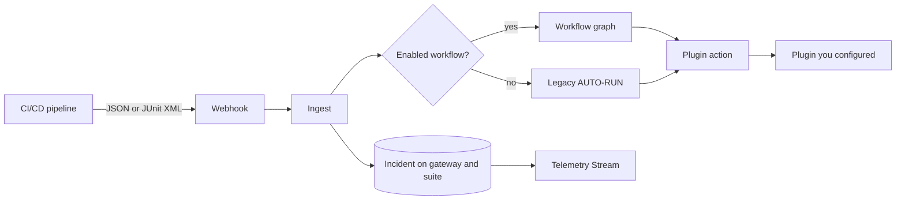

# SRE Capsule — SRE Control Plane

**Version: 1.0.17-beta**

**SRE Flight Recorder** (SRE Capsule) is the control plane for CI/CD and end-to-end test failures. A failure becomes an incident on a gateway and a suite: status, owner, history, and the steps of that run. Leads and managers work the incident. Managers read reliability and cost. The product records what happened. It does not invent a cause.

---

## What Problem Does It Solve?

A pipeline log is a signal. It is not the record the team works from. SRE Capsule keeps that record.

1. **The failure stays with the suite and the gateway.** The next run of the same test does not start from a blank page. Activity opens the steps. Suite health compares the last run with the last green run.
2. **Someone owns the response, or the gap is visible.** Detected, acknowledged, mitigated, and resolved are different moments. Severity says how badly it hurts. An incident with no owner stays on the Unowned queue.
3. **The work on that failure is explicit.** A lead or a manager can analyze it, confirm a change, and re-run. A workflow on that gateway runs only when it is enabled. The graph holds the condition and the message. Plugin Engine holds the connection. The incident **Runbook** button does not call Slack, Jira, or a cluster.
4. **Reliability and cost stay on the same record.** Managers read deployment frequency, lead time, change-failure rate, MTTR, and the error budget. A maintenance window explains a failure you already expect. The incident stays on Telemetry Stream.

---

## Core Capabilities

| Capability | Description |
|---|---|
| **Smart Correlation** | SHA-256 fingerprinting (`name\|error`) deduplicates failures per pipeline run (`X-Run-Id`). |
| **Flaky Test Detection** | Re-failure within 48h after resolution → `[FLAKY]` prefix; CLI can query flaky status by hash. |
| **Performance Regression** | `execution_time_ms` on passed tests; alert `[PERF]` when duration exceeds 150% of 30-day average. |
| **Dimensional Tags** | Ingest `browser`, `os`, `viewport`; auto-extract `@jira-PROJ-123` from test names. |
| **Test Artifacts** | Upload trace zips, screenshots, videos per incident (`POST /api/incidents/{id}/artifacts`). |
| **Native Integrations** | Go HTTP engine (Slack, Jira, Teams, PagerDuty, Opsgenie, webhooks, email) — **no shell scripts**. |
| **Plugin Engine** | JSON manifests under `plugins/`; loaded once at startup; manual test from UI. |
| **Visual Workflow DAG** | Per-gateway Drawflow editor; conditions + native actions; simulate before save. |
| **AI RCA** | OpenAI / Ollama async root-cause summaries per incident. |
| **Quarantine** | The deny-list engine is off in Community. Incidents are not skipped. |
| **Runbooks** | One-click apply validated workflow templates (502, flaky, OOM, …). |
| **DORA metrics** | Deployment frequency, lead time, CFR, MTTR, per-gateway error budget (SLO 1–50%), maintenance windows. |
| **FinOps & Analytics** | MTTR, CI minutes lost, flaky cost, customizable dashboard charts, PDF export. |
| **Developer CLI** | `srecapsule run` wraps local tests and warns on known flaky fingerprints. |
| **Playwright Reporter** | Real-time failure POST + optional trace zip upload. |
| **Multi-Tenancy & RBAC** | Teams, project-scoped visibility, roles: Platform Admin, Manager, Lead, Observer. |
| **Universal CI/CD Gateways** | JSON webhooks, JUnit XML upload, GitHub / GitLab / Jenkins guides. |

---

## Architecture Overview



See the full breakdown in [System Architecture](guides/architecture.md).

1. **Ingestion** - `POST /api/webhooks/` (JSON) or `POST /api/webhooks/upload` (JUnit XML).
2. **Enrichment** - Dimensions, execution time, a performance regression, and the flaky tag when the same test fails again after a resolve.
3. **Correlation** - Fingerprint plus `pipeline_run_id`, so the same open failure in one run is one incident.
4. **Record** - The incident stays on that gateway and that suite: status, owner, and the steps.
5. **Remediation** - An enabled workflow runs the graph. Otherwise legacy AUTO-RUN can call a plugin that is on the gateway allow list. The connection stays in Plugin Engine. The workflow action holds the message for that gateway.
6. **Evidence** - Artifacts upload to local storage. AI RCA, when a manager has enabled a provider, may summarize the record. It does not add a cause that is not already there.

---

## Quick Start

```bash
git clone https://github.com/SRE-Capsule/sre-capsule-community.git
cd sre-capsule-community
docker compose up -d --build
```

Open **http://localhost:9000** — default login `admin` / `admin` (password change required on first login).

Build the developer CLI:

```bash
go build -o bin/srecapsule-cli ./cmd/cli
```

---

## Documentation Map

| Section | What you will learn |
|---|---|
| [**Feature catalog**](reference/feature-catalog.md) | **Complete list** of UI, API, CLI, and ops features |
| [Security & JWT](setup/security-authentication.md) | Login, API keys, MCP token, production checklist |
| [Utility binaries](reference/utility-binaries.md) | `srecapsule`, agent, listusers, resetpass |
| [Editions](guides/editions-community-enterprise.md) | Community vs Enterprise build tags |
| [MCP & self-healing testing](guides/mcp-self-healing-testing.md) | UI, API, MCP, CLI validation guide |
| [Operations & health API](api/operations-health.md) | `/healthz`, `/readyz`, `/metrics` |
| [Design Schemas & Diagrams](guides/design-diagrams.md) | **C4, ER, sequences, state machines, RBAC, deployment** (18 diagrams) |
| [System Architecture](guides/architecture.md) | Packages, data flows, remediation modes, concurrency |
| [Platform User Guide](guides/platform-user-guide.md) | Every feature step-by-step (dashboard → DORA) |
| [Docker Deployment](setup/docker.md) | Production-ready container setup |
| [System Configuration](setup/config.md) | SMTP, storage, security policy |
| [RBAC & Teams](setup/rbac-teams.md) | Roles, teams, project access |
| [CI/CD Overview](integration/cicd-overview.md) | Pipeline integration checklist |
| [All test frameworks](integration/test-frameworks.md) | **20+ guides**: Playwright, Cypress, Pytest, Robot, Newman, Selenium, JUnit, TestNG, Jest, NUnit, Go, PHPUnit, RSpec, Karate, Appium, Cucumber, K6, … |
| [CI/CD providers](integration/cicd-providers.md) | GitHub, GitLab, Jenkins, Azure DevOps, CircleCI, Bitbucket, … |
| [JUnit XML Upload](integration/junit-xml-upload.md) | Structured multi-test ingestion |
| [Playwright Reporter](integration/playwright-reporter.md) | Real-time reporter + trace upload |
| [Webhooks API](api/webhooks.md) | JSON payload, batch mode, headers |
| [Incidents API](api/incidents-api.md) | Resolve, artifacts, flaky check |
| [SRE theory and the product](guides/sre-theory.md) | Each SRE practice, then the SRE Capsule screen that does it |
| [Incident Lifecycle](guides/incident-lifecycle.md) | Correlation, flaky, perf alerts, acknowledge, same cause |
| [Artifacts & CLI](guides/artifacts-and-cli.md) | Upload, storage, local wrapper |
| [Plugin Engine](plugins/overview.md) | Native Go integrations (manifests) |
| [Visual Workflow Builder](plugins/visual-workflow.md) | DAG editor, simulate API, enable/draft/legacy modes |
| [Plugin configuration guide](plugins/configuration-guide.md) | Two-sided setup (SRE Capsule + vendor) with logos |
| [Integrations catalog](plugins/integrations-catalog.md) | All plugins — Slack, Jira, PagerDuty, Datadog, TestRail, … |
| [Dashboard Guide](guides/dashboard-operations.md) | Filters, resolve, exports |
| [AI RCA & Quarantine](guides/intelligence-quarantine.md) | LLM summaries, deny-list, CI API |
| [Runbooks & DORA](guides/runbooks-dora.md) | Templates, metrics, Prometheus |

---

## Technology Stack

- **Backend:** Go 1.25+ (`modernc.org/sqlite`, modular `pkg/storage`, `pkg/service`, `pkg/integrations`)
- **CLI:** Cobra (`cmd/cli`)
- **Frontend:** Vanilla JavaScript ES6+, Chart.js
- **Reporter:** TypeScript Playwright custom reporter (`examples/playwright-reporter/`)
- **Documentation:** MkDocs Material (this site)
